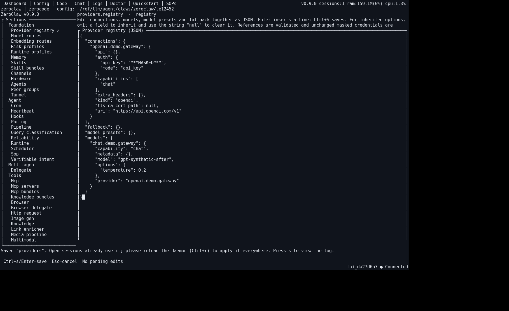

# PR #12452: ZeroCode registry edit/save/reopen evidence

- Tested source revision: `904b56d40d7849f69ee6aff31952fd141949723c`.
- Test date: November 16, 2026.
- Client and daemon: built together from that revision (`zerocode` and `zeroclaw`, both display version 0.9.0).
- Terminal: xterm, 160 columns by 50 rows, English locale. TUI connected through the matching daemon's local Unix socket.
- Screenshot: actual xterm window captured with ImageMagick `import` on an isolated Xvfb display (1800 by 1100 pixels). The UI was not reconstructed or redrawn for the evidence.
- Data: synthetic connection, model and credential only; no provider inference request was made.

## Build

```sh
cargo build --offline --locked -p zeroclaw -p zerocode --bins
```

Built successfully using the worktree's `target` directory. Toolchain: `rustc 1.100.0 (0ef1bc386 2026-11-09)`, `cargo 1.100.0 (3acc79c0c 2026-11-05)`.

Binary SHA-256:

```text
zerocode 846f9190cbaa7afc58db051dfc2fe91d84f640514c9311a4a1d43b5f53ba9e4c
zeroclaw 6eb2248c663faa05221ca5c07972048ea3a4c443f9b223596b90e5633c5cf422
```

## Actual interaction and observed result

1. Start ZeroCode with an isolated V5 config, a synthetic `openai.demo.gateway` connection and a `chat.demo.gateway` model. The enabled default agent references that model and a supervised risk profile.
2. Open **Config > Provider registry > providers.registry**.
3. Edit only `models["chat.demo.gateway"].model`: `gpt-synthetic-before` -> `gpt-synthetic-after`.
4. Press **Ctrl+S**. The editor closes and the supported interface reports: `Saved "providers". Open sessions already use it; please reload the daemon (Ctrl+r) to apply it everywhere.`
5. Press **Enter** to reopen the registry through the matching daemon. The editor displays the intact dotted model/connection keys, `"model": "gpt-synthetic-after"`, `"api_key": "***MASKED***"`, and `No pending edits`.
6. Independently parse the saved `config.toml` with Python `tomllib`. Confirm that the literal dotted model key holds `gpt-synthetic-after`, the stored credential was not replaced by `***MASKED***`, and the stored credential does not occur in the captured terminal text.

**Result: PASS.** This verifies the real TUI edit/save/reopen interaction and on-disk persistence. It does not claim a provider inference request, Quickstart smoke, or a complete backend test matrix.

The initial minimal fixture omitted the enabled agent's required risk profile; the backend correctly rejected that save and retained the draft. The fixture was completed with a supervised risk profile before performing the successful sequence above. Unix socket creation required running the local test outside the execution sandbox; no product permission or validation rule was changed.

## Direct screenshot after reopening



Raw supported-interface captures: [save result](saved-terminal.txt) and [reopened editor](reopened-terminal.txt).

These artifacts live in a standalone evidence branch; they are not added to the implementation PR's diff.
