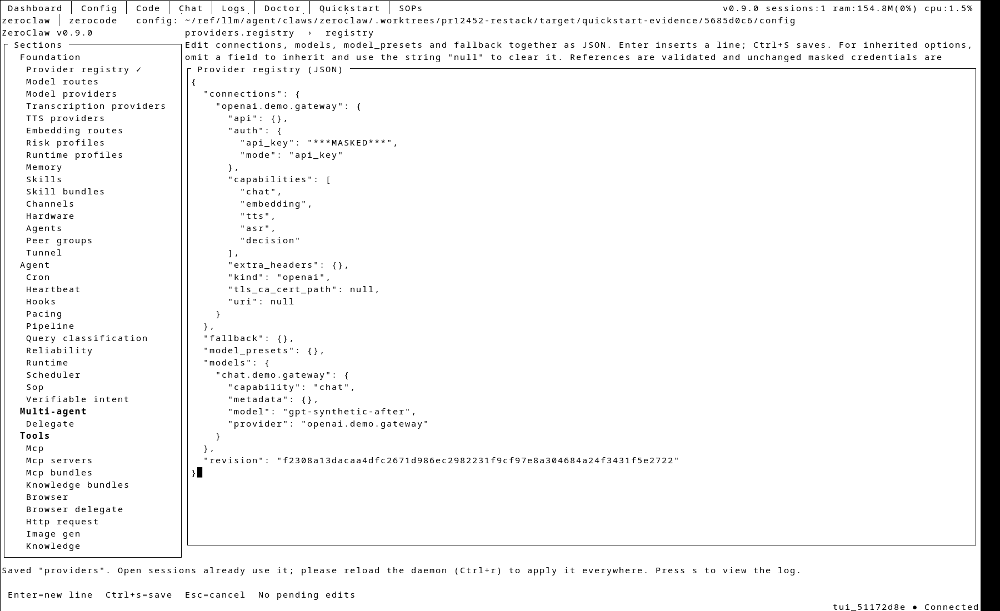
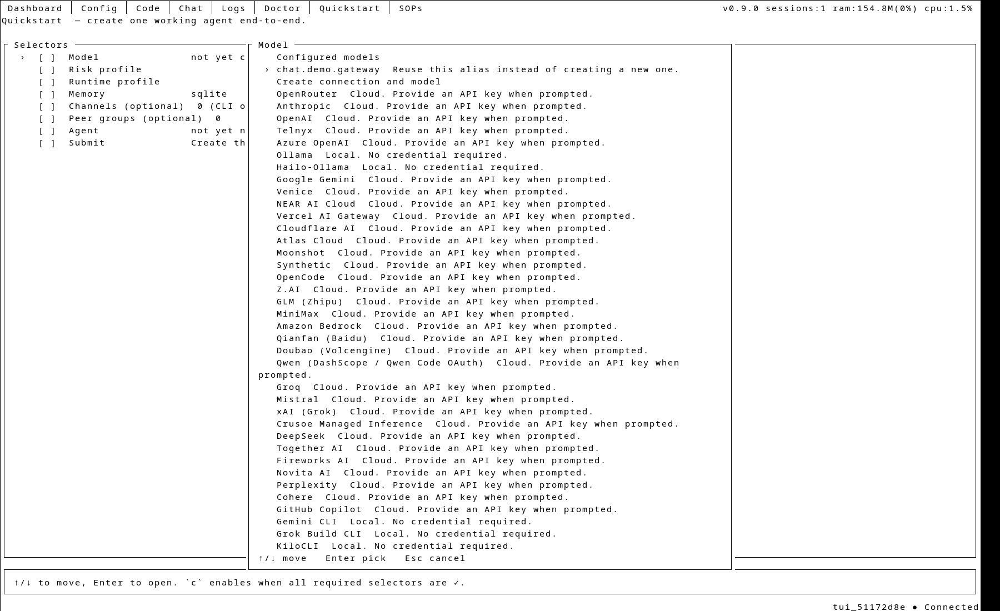
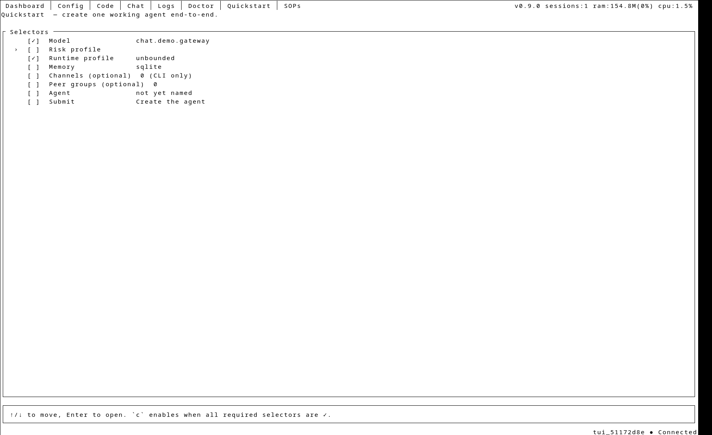
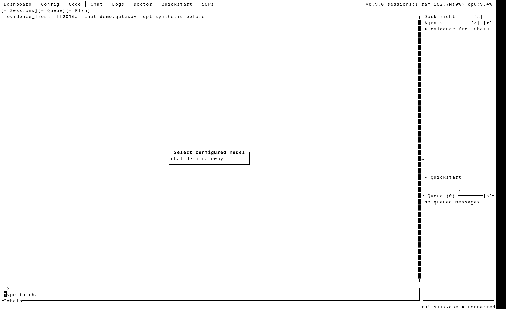
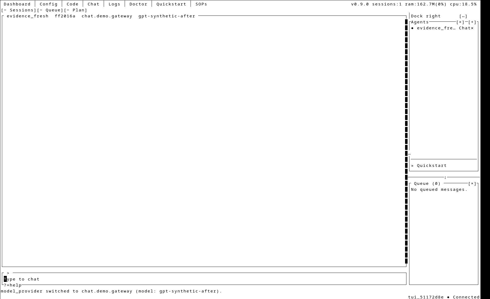

# PR #12452: current-head terminal evidence

- Tested source revision: `5685d0c6700ff0a6d5687cd1ae1d398248053c33`.
- Captured November 21, 2026; English locale; actual xterm at **160 columns × 50 rows**, confirmed from the tmux pane dimensions with its status line disabled.
- Both client and daemon were built together from that revision, using this worktree's `target` directory. The daemon listened only on localhost and an isolated Unix socket.
- PNGs are direct ImageMagick captures of the actual xterm on an isolated 1800×1100 Xvfb display. The UI was not redrawn or reconstructed. Text files are direct `tmux capture-pane` output from the same moments.
- Only synthetic agent, connection, model and credential data was used. No provider inference request was made. Configuration files, secret keys, daemon state and tokens are deliberately excluded from this evidence repository.

## Build and identity

```sh
RUSTC_WRAPPER= CARGO_TARGET_DIR=target cargo build --offline --locked -p zeroclaw -p zerocode --bins
```

The final incremental build passed in 34.07 seconds. A preceding post-master build also passed (11m 58s). No local full test matrix was run; GitHub CI owns automated validation.

Binary SHA-256:

```text
zerocode b391f113679bd297e5531662374ee4c74d797c3fc2226ca6c064e5b700c5fc91
zeroclaw 9e616010be6f0e1e6006b1a46c210af4b6685166977f55928f285c1ff1fabf6d
```

## 1. Registry edit, save and reopen

Open Config → Provider registry → providers.registry. Change only the model ID for the literal model key `chat.demo.gateway` from `gpt-synthetic-before` to `gpt-synthetic-after`. Press Ctrl+S and Enter to reopen.

The reopened editor shows both complete dotted names (`chat.demo.gateway` and its connection `openai.demo.gateway`), the saved model ID, `"api_key": "***MASKED***"`, the current `revision`, and `Enter=new line  Ctrl+s=save  Esc=cancel  No pending edits`. The save feedback is visible too. Independently parsing the saved TOML confirmed the exact model key holds `gpt-synthetic-after` and the stored credential is not the mask. The synthetic credential does not occur in any text capture.



[Save result](saved-terminal.txt) · [Reopened terminal output](registry-reopened-terminal.txt)

## 2. Quickstart configured-model selection

Open Quickstart → Model. The Configured models list shows the complete `chat.demo.gateway` key. Selecting it returns to the selectors with the Model row checked and the same key.




[Picker output](quickstart-picker-terminal.txt) · [Selected output](quickstart-selected-terminal.txt)

## 3. Chat model-provider selection

Open Chat and submit `/model-provider`. Select `chat.demo.gateway` from Select configured model. Both the session title and success feedback show the resolved model ID `gpt-synthetic-after`:

```text
model_provider switched to chat.demo.gateway (model: gpt-synthetic-after).
```

This also exercises the feedback correction at the tested revision: canonical model references do not require a separate model override, and the feedback reuses the registry result used for the title.




[Picker output](chat-picker-terminal.txt) · [Selected output](chat-selected-terminal.txt)

**Result: all three focused manual workflows passed.** These artifacts are isolated from the implementation PR diff.
